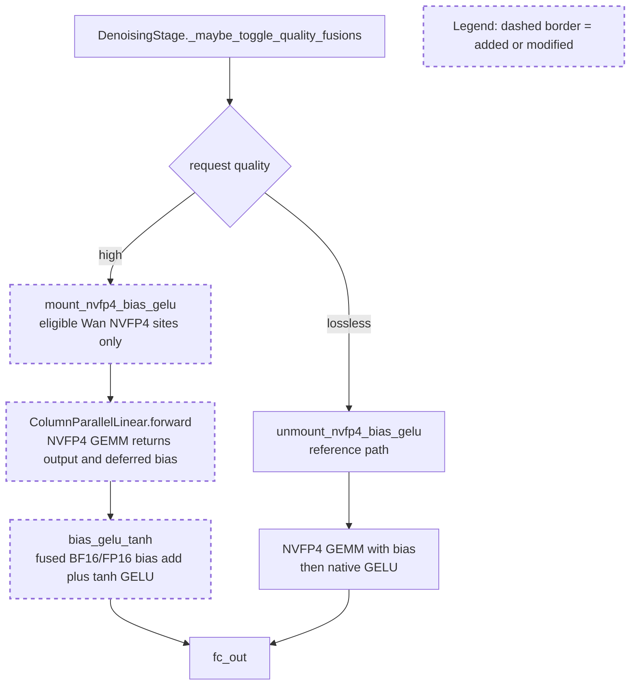

## Upstream PR description (verbatim excerpt)

<!-- upstream-excerpt-start -->
## Motivation

Wan2.2 ModelOpt NVFP4 MLPs currently execute the `fc_in` hot path as three
separate operations:

```text
NVFP4 GEMM -> BF16 bias add -> tanh GELU
```

On GB300, the bias add and GELU are memory-bound and account for a meaningful
part of denoising time. This PR fuses the last two operations while preserving
the eager half-precision rounding boundary.



The request-scoped quality gate only defers `fc_in` bias when the live linear
method is `ModelOptFp4LinearMethod`. Unquantized checkpoint-excluded linears and
the defa
<!-- upstream-excerpt-end -->

## Changed files (upstream)

- `python/sglang/kernels/jit/csrc/elementwise/bias_gelu.cuh`
- `python/sglang/kernels/ops/diffusion/__init__.py`
- `python/sglang/kernels/ops/diffusion/sites/nvfp4_bias_gelu_site.py`
- `python/sglang/kernels/ops/elementwise/bias_gelu.py`
- `python/sglang/multimodal_gen/runtime/layers/mlp.py`
- `python/sglang/multimodal_gen/runtime/models/dits/wanvideo.py`
- `python/sglang/multimodal_gen/runtime/pipelines_core/stages/denoising.py`
- `python/sglang/multimodal_gen/test/unit/test_wan_gelu_mlp.py`
- `test/registered/kernels/benchmark/elementwise/bench_bias_gelu.py`
- `test/registered/kernels/ops/elementwise/test_bias_gelu.py`
