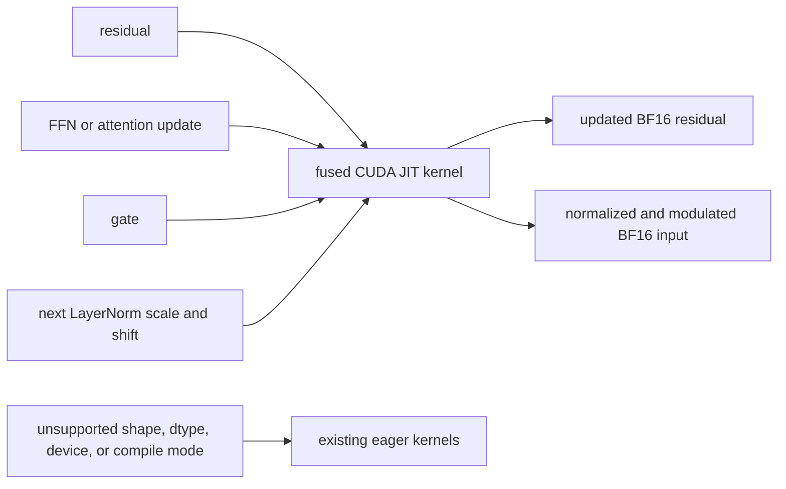

## Upstream PR description (verbatim excerpt)

<!-- upstream-excerpt-start -->
## Summary

This PR adds a Blackwell JIT fast path for FLUX.2's gated residual update followed by LayerNorm and adaLN scale/shift. It is the gated-residual-normalization optimization described in [Agentic Kernels in Production](https://www.baseten.co/blog/agentic-kernels-in-production/).

The production BF16 path previously launched `residual_gate_add` and LayerNorm/modulation separately. The new path carries an eligible FFN residual update to the next block and materializes both results with one model-specific CUDA kernel:

In a profiled denoise step, 80 gated-residual and 80 norm/modulate calls become 77 fused calls plus 3+3 boundary calls. This removes 77 GPU launches per step.

## Implementation details

- Adds a dedicated D=6144, 128-thread CUDA JIT kernel for FLUX.2 instead of widening the generic norm/custom-op surface.
- Preserves eag
<!-- upstream-excerpt-end -->

## Changed files (upstream)

- `python/sglang/kernels/jit/csrc/diffusion/flux2_gated_resnorm.cuh`
- `python/sglang/kernels/ops/diffusion/__init__.py`
- `python/sglang/kernels/ops/diffusion/norm/flux2_gated_resnorm_jit.py`
- `python/sglang/multimodal_gen/runtime/models/dits/flux_2.py`
- `test/registered/jit/test_flux2_gated_resnorm.py`
